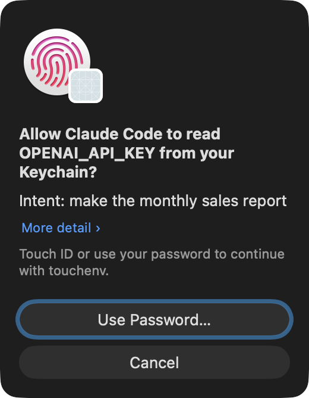

# touch-env

**Lock your passwords and API keys behind your fingerprint, so AI agents can't read them without your touch.**

<p align="center"></p>

Each time something needs one of your secrets, your Mac shows this. Touch the sensor and that one command gets the
key. Don't touch, and nobody gets it.

## Why

**It happened to a friend.** They were running a Vite dev server (Node.js) on their laptop. They thought it was
private, because only their Tailscale network could reach it.

Then another machine on that network was hacked. From there, the attacker reached the dev server and used it to
read files on the laptop: `.env` files, API tokens, cloud keys. Nobody touched the keyboard. The stolen keys then
opened the doors to other systems.

The keys were sitting in plain files, and anything that could read a file could take them.

**AI coding assistants add one more way in.** Claude Code, Codex and Cursor run commands as you, so they can open
every file you can. A mistake, or a booby-trapped web page or project they read, can make them copy a key out.

touch-env works like a **hardware security key for your secrets**:
- Keys move out of files into the Mac's Keychain, behind Touch ID.
- Nothing can read a key without your finger on the sensor: not a hacked dev server, not malware, not an AI agent.
- A file-reading bug finds nothing to steal.
- Code that asks for a key triggers a prompt on your screen, saying **who** wants **which key** for **what
  command**. If you didn't start it, don't touch.

## Install

You need macOS 13 or later. With [Homebrew](https://brew.sh):

```sh
brew install --cask ptrinh/tap/touchenv
touchenv --version
```

<details><summary>Without Homebrew</summary>

1. Download `touchenv-…-macos.zip` from [Releases](https://github.com/ptrinh/touch-env/releases/latest).
2. Open **Terminal** and paste:

   ```sh
   mkdir -p ~/Applications ~/.local/bin
   unzip ~/Downloads/touchenv-*-macos.zip -d ~/Applications
   ln -sf ~/Applications/touchenv.app/Contents/MacOS/touchenv ~/.local/bin/touchenv
   echo 'export PATH="$HOME/.local/bin:$PATH"' >> ~/.zshrc
   ```

3. Open a new Terminal window and check that it works: `touchenv --version`

</details>

## Use

**Save a key.** It asks you to paste the key, and the key is not shown on screen:

```sh
touchenv set OPENAI_API_KEY
```

**Save a key file** (`.p8`, `.pem`, `.json`):

```sh
touchenv set MY_KEY < ~/Downloads/AuthKey.p8
```

**Use a key on all your Macs.** Add `--sync` and the key travels to your other Macs through iCloud Keychain:

```sh
touchenv set --sync OPENAI_API_KEY
```

Each Mac needs touchenv installed. `touchenv ls` marks synced keys with `(iCloud)`.

After saving, delete the original. Keep a backup somewhere offline, such as a USB stick.

**Use a key.** Put `touchenv run NAME --` in front of the command:

```sh
touchenv run OPENAI_API_KEY -- python report.py
touchenv run MY_KEY:file -- fastlane beta     # :file means the command gets the key as a file path
```

**Say why.** Add `--intent` and the prompt shows that line under the question. Click **More detail** in the
prompt to see the exact command:

```sh
touchenv run --intent "make the monthly sales report" OPENAI_API_KEY -- python report.py
```

**Other commands:**

| Command | What it does | Asks for Touch ID? |
|---|---|---|
| `touchenv ls` | Lists the names of your saved keys | No |
| `touchenv get NAME` | Shows a key on screen | Yes |
| `touchenv rm NAME` | Deletes a key | Yes |

## Telling your AI assistant

Add this line to your assistant's instructions, for example `CLAUDE.md` or `AGENTS.md`:

> My secrets are in touchenv. Never read key files. To run a command that needs one, use
> `touchenv run --intent "<why, in a few words>" NAME -- <command>` and I'll approve it with Touch ID.

If you use Claude Code, also add `"touchenv *"` to `sandbox.excludedCommands` in `~/.claude/settings.json`.

## Good to know

- **Read the prompt before you touch.** Once you approve, that command can use the key however it wants. If the
  command looks strange, don't touch.
- **The intent is what the asker says about itself.** Anyone can write anything there. Open **More detail** and
  check the command.
- **Your keys stay on your Mac** unless you add `--sync`. touch-env itself has no internet access.
- **Synced keys are protected a little differently.** iCloud Keychain does not accept the "ask for Touch ID on every
  read" lock that macOS puts on local keys. Only touchenv can read a synced key, and touchenv always asks for your
  finger first, but the lock is touchenv's, not the Mac's. Apple encrypts synced keys end to end.
- **No Touch ID?** Your Mac asks for your login password instead.
- **Other apps can't see the keys at all.** Not even Apple's own `security` tool can read them. There is also no
  "Always Allow" button you could click by mistake.
- **touch-env can't clean up old copies.** Copies of a key that are already elsewhere, such as old files, backups or
  shell history, are still there. Delete them yourself.

## For developers

touch-env is one Swift file, [`touchenv.swift`](touchenv.swift).

**How it works:**
- Keys are stored in the Data Protection keychain with a `userPresence` access control and
  `WhenUnlockedThisDeviceOnly`. Keys saved with `--sync` are `kSecAttrSynchronizable` and `WhenUnlocked`, with no
  access control (iCloud Keychain refuses one); touchenv's own prompt guards their reads.
- They sit in a keychain access group that only the signed app holds. This is why it ships as a signed `.app` with a
  provisioning profile.
- The prompt names the nearest parent process that isn't a shell.
- The prompt is touchenv's own window with Apple's `LAAuthenticationView` inside it, so only a finger approves (there
  is no Allow button). "Use Password…", or a Mac without Touch ID, falls back to the standard macOS dialog.
- The Touch ID disc is the one macOS uses (LocalAuthenticationCoreUI). `Resources/` keeps a copy for when a
  macOS release moves it.
- `NAME:file` writes the key to a `0600` file in a private temp folder. The folder is deleted when the command ends.

**Building it yourself** needs a paid Apple Developer account:
1. Register a macOS App ID.
2. Create a Developer ID provisioning profile for it.
3. Put these values in `build.local`, then run `./build.sh`:
   - `TOUCHENV_TEAM_ID`
   - `TOUCHENV_BUNDLE_ID`
   - `TOUCHENV_SIGN_ID`
   - `TOUCHENV_PROFILE`

   The header of `build.sh` explains each one.

Keys saved by the prebuilt app can't be read by your own build, because the two use different signatures. Move them
over with:

```sh
old run A:file -- sh -c 'touchenv set A < "$A"'
```

## License

MIT
