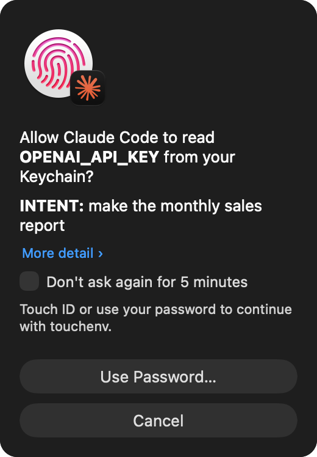

# touch-env

**API keys behind your fingerprint, on a Mac (Touch ID) or a Windows PC (Windows Hello): no app, script or AI agent
reads them without you.**

<p align="center"></p>

Keys in `.env` files can be taken by anything that reads files: a hacked dev server, malware, or an AI agent tricked
by a web page. touchenv keeps them locked instead: in the Keychain on a Mac, in a store encrypted to a Windows Hello
key on a PC. Each use shows **who** wants **which key** and **why**, and only you say yes. The commands are the
same on both; [what differs](#mac-and-windows-what-differs) is in one table below.

## Install

**Mac** (macOS 13 or later):

```sh
brew install --cask ptrinh/tap/touchenv
```

Or unzip the app from [Releases](https://github.com/ptrinh/touch-env/releases/latest) into `~/Applications` and
link `touchenv.app/Contents/MacOS/touchenv` into your `PATH`.

**Windows** (10 or 11, x64 or Arm, with Windows Hello set up; beta): download
`touchenv-<version>-windows-x64.zip` (or `-arm64`) from
[Releases](https://github.com/ptrinh/touch-env/releases/latest) and put `touchenv.exe` in a folder on your `PATH`.
The exe is signed by SENPRINTS LLC. Checking the download, and the service that grants need:
[docs/windows.md](docs/windows.md).

## Everyday use

```sh
touchenv set OPENAI_API_KEY                  # save: paste it, it isn't shown
touchenv set MY_KEY < AuthKey.p8             # save a key file
touchenv set --sync OPENAI_API_KEY           # Mac only: save and sync to your other Macs (weaker: see below)
touchenv run OPENAI_API_KEY -- python report.py      # the command gets it in the OPENAI_API_KEY variable
touchenv run MY_KEY:file -- fastlane beta    # the command gets a private temp file's path, deleted afterwards
touchenv get NAME                            # print it
touchenv ls                                  # names only; on a Mac "(iCloud)" marks synced ones
touchenv rm NAME
```

Delete the original files after saving. Old copies (backups, shell history) are still yours to delete.

`--intent "why"` after the command puts a reason in the prompt: `touchenv run --intent "monthly report" KEY -- …`.
AI agents (Claude Code, Codex, Cursor's agent, Gemini CLI, aider, Goose, opencode) **must** give one: without it
touchenv refuses before any prompt and tells the agent how to ask again. Typed in your own terminal it is
optional; without it the prompt says **No reason given** and shows the command.

**For AI assistants**, add to `CLAUDE.md` / `AGENTS.md`:

> My secrets are in touchenv. Never read key files. Use `touchenv run --intent "<why>" NAME -- <command>`.

On a Mac, Claude Code also needs `"touchenv *"` in `sandbox.excludedCommands`.

## Mac and Windows: what differs

| | Mac | Windows (beta) |
|---|---|---|
| You approve with | Touch ID, or the Mac password in the system's window | Windows Hello: fingerprint, face or PIN |
| Where keys are kept | The macOS Keychain, in a group only the signed touchenv can open | `%LOCALAPPDATA%\touchenv\store.json`, encrypted to a key Windows Hello holds (in the TPM when the PC has one) |
| Who checks each read | macOS and the Secure Enclave, for local keys | Windows Hello, asked by touchenv |
| Syncing keys to your other machines | `--sync`, through iCloud Keychain | No: keys stay on the PC |
| 5-minute approvals and timed grants | Built in | After `touchenv service install`, once. While one is on, any program running as you can collect those keys |
| Standing grants, the access log, `--password` | Yes | Not yet |

All of the Windows side: [docs/windows.md](docs/windows.md).

## Local or synced? (Mac)

On Windows every key is local to the PC. On a Mac you choose per key:

| | Local key, Touch ID required | Synced key (`--sync`) |
|---|---|---|
| **Use it for** | Production keys: SSH, signing, deployment, payments | Staging and dev keys, read-only keys, keys that aren't critical |
| Saved with | `touchenv set NAME` | `touchenv set --sync NAME` |
| Where it is | This Mac only | This Mac and every other Mac on your Apple Account, through iCloud Keychain |
| Who checks each read | macOS and the Secure Enclave: without your finger the key isn't decrypted | touchenv's own code: it asks for Touch ID, then reads the key |
| Malware running as you | Can't read it | Can't read it |
| An attacker with admin rights who turns off SIP | Still needs your finger | Can read it |
| Another Mac on your Apple Account is taken over | Nothing to take: the key isn't there | Exposed |
| A new or lost Mac | `export` / `import` ([docs/new-mac.md](docs/new-mac.md)). A Mac lost before an export takes the key with it | Already on the new Mac |
| Approving away from the Mac | No, except a grant made beforehand | `--password` over SSH |

## Not being asked every time

All of this is in [docs/grants.md](docs/grants.md). On Windows the first two need the touchenv service
(`touchenv service install`, once) and the next two don't exist yet.

- **For 5 minutes.** Tick "Don't ask again for 5 minutes" on a `run` prompt: the same app gets those keys from
  `run` without asking until then.
- **While you step away.** `touchenv grant --for 8h --uses 20 KEY …`: one approval, then the app you ran it from,
  and what it runs, gets those keys from `run`, also while the machine is locked, until the time or the uses run
  out.
- **One program, from now on** (Mac). `touchenv grant --always --for-program ~/bin/helper.sh KEY`: that script
  (bound to its contents) or signed program reads the key with `get` or `run` without asking, until you revoke it.
  For helpers that run unattended, such as from scheduled tasks.
- **No sensor at hand** (Mac). `--password` on `get`, `run` or `grant` takes your Mac password, typed in the
  terminal, for iCloud-synced secrets only.
- `touchenv lock` ends 5-minute approvals and timed grants. To see what is allowed: `touchenv grant --list` on a
  Mac (`lock --all` ends standing grants too), `touchenv status` on Windows.

## Who read what (Mac)

`touchenv log` prints the access log: every read with who asked, the calling program, the intent and how it was
approved or refused; grants, `set`, `rm`, export and import too. Never a value. `touchenv log --summary` shows
which programs ask for each secret most. Kept two years. See [docs/access-log.md](docs/access-log.md).

## SSH keys

`touchenv ssh add ~/.ssh/id_ed25519` keeps an SSH key behind Touch ID or Windows Hello. touchenv then acts as
your SSH agent (`touchenv ssh agent install --config`), asking for every signature and showing the server. On
Windows that is the agent for Windows' own OpenSSH. On a Mac it can also load the key into `ssh-agent` for a while
(`touchenv ssh load --for 8h`). touchenv never deletes your key file. See [docs/ssh.md](docs/ssh.md).

## Moving to a new Mac or PC

A backup or a migration tool doesn't give you working keys on another machine (a synced key on a Mac is the
exception). `touchenv import --begin` on the new machine, `touchenv export --to tenv1:… > keys.tenv` on the old
one, `touchenv import keys.tenv` on the new one: the file opens only on that machine, once, within an hour. It
works between a Mac and a PC in both directions. See [docs/new-mac.md](docs/new-mac.md).

## Good to know

- **Read before you touch.** An approved command can do anything with the key. The intent is written by whoever
  asks; check the command: its first lines are always in the prompt, all of it under **More detail** (a very long
  one as its start and its end, with how much is left out between).
- **On a Mac, local keys are locked by macOS; synced keys (`--sync`) are guarded by touchenv.** iCloud Keychain
  won't take the Touch ID lock, so a synced key is also open to a macOS bug or a bug in touchenv. Keep signing keys
  and admin tokens local: see [Local or synced?](#local-or-synced-mac).
- **On Windows, only approve a prompt you were expecting.** Any program running as you can ask Windows Hello and
  write the prompt's text itself. Read who is asking.
- **What an approval doesn't cover.** Once you approve, the command has the key. A 5-minute approval or a grant
  lets anything that app runs (or, for a standing grant, anything that can run that program) take those keys
  without asking; on Windows, any program running as you while it is on. Grant the fewest keys, the shortest time
  and the fewest uses the task needs.
- **No fingerprint sensor?** A Mac asks for your Mac password in the system's window; Windows Hello takes your PIN.

The whole picture, including what a typed password and a standing grant don't protect against:
[docs/security.md](docs/security.md). Building and testing: [docs/building.md](docs/building.md).

## See also

[bordercheck](https://github.com/ptrinh/bordercheck) finds the keys still lying around in plain text on a work
laptop (`.env` files, shell history, SSH keys without a passphrase, tokens in AI agent configs) and the other
open doors, so you know what to move into touch-env.

## License

MIT
